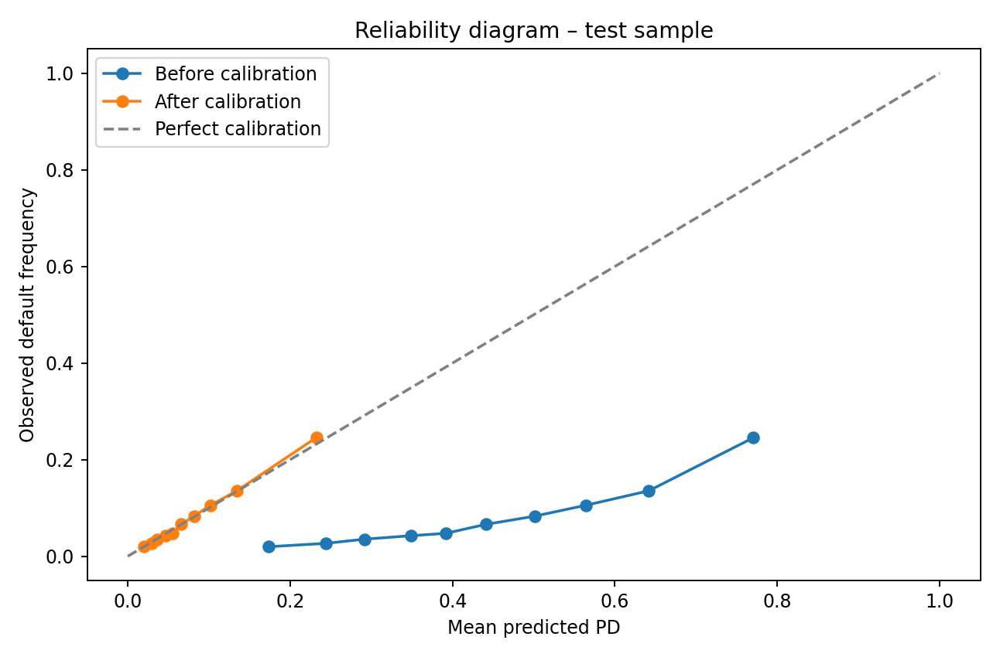
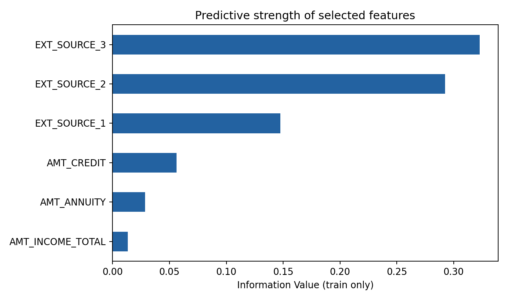
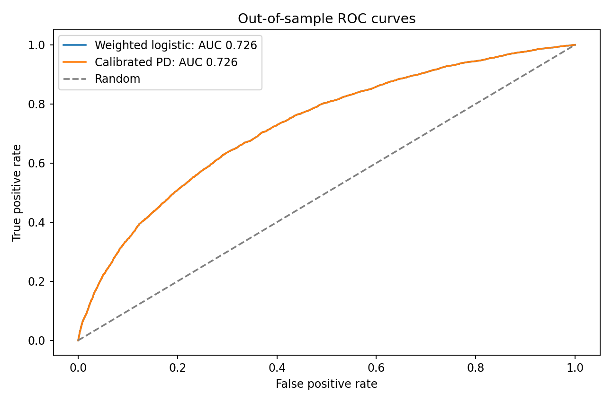
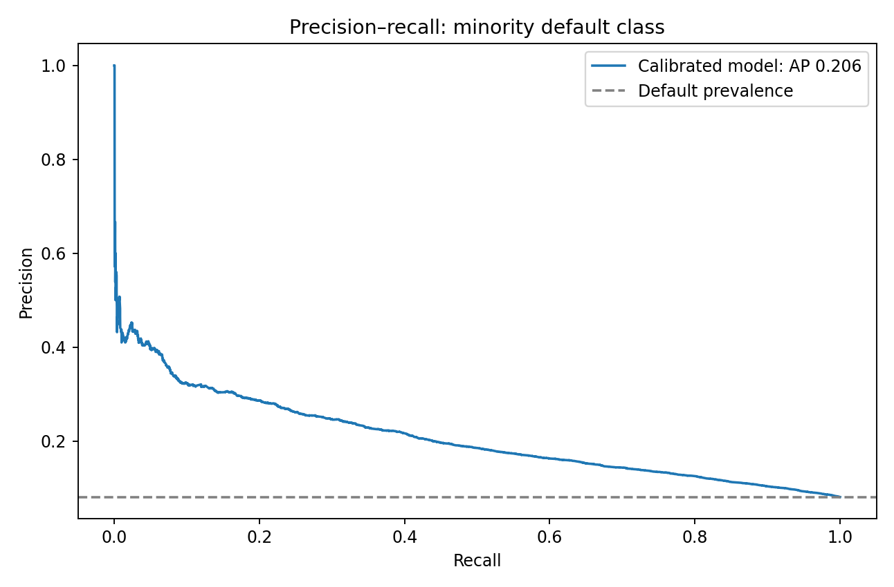

# Home Credit: Credit Risk, Probability of Default & Expected Loss

[](https://colab.research.google.com/github/giorgiomascoli/-home-credit-risk-analysis/blob/main/notebooks/Home_Credit_PD_Expected_Loss.ipynb)

**A transparent Python credit-risk study** that uses supervised Weight of Evidence (WoE), Information Value (IV), class-balanced logistic regression, holdout probability calibration and an educational portfolio Expected Loss (EL) calculation.

> **Core question:** Can we estimate better-calibrated probabilities of repayment difficulty and use them in an interpretable credit-risk exposure analysis?



## Key results — holdout test sample

The full analysis was executed locally on **23 November 2026** using the user's 25-column Home Credit teaching extract (**307,511 loan applicants**). It uses the same six numeric predictors available in the original Kaggle training data. Fixed random seed: **42**.

| Metric | Result |
|:--|--:|
| Applicants | **307,511** |
| Training / calibration / final test | 184,506 / 61,502 / 61,503 |
| Observed event rate, test | **8.07%** |
| ROC-AUC, final test | **0.7256** |
| Average precision (PR-AUC summary), final test | **0.2063** |
| Mean raw PD (class-balanced model) | **43.68%** |
| Mean calibrated PD | **8.01%** |
| Brier before → after calibration | **0.2103 → 0.0696** |
| Constant-prevalence baseline Brier | 0.0742 |
| Assumed LGD | **45%** |
| Test loan-amount exposure proxy | **36,765,080,145** data currency units |
| Illustrative test-sample EL | **1,200,182,055** data currency units |
| Illustrative EL / exposure | **3.26%** |

The **balanced classifier at threshold 0.5** has the following confusion matrix, ordered as `[TN, FP] / [FN, TP]`:

```
[38234, 18304]
[1702, 3263]
```

The raw PD mean of **43.68%** is not a reliable portfolio probability because class weighting changes the training objective. Holdout sigmoid calibration brings mean predicted PD close to the observed **8.07%**. Calibration does **not** create new rank-order information: both raw and calibrated models have ROC-AUC **0.7256**. The final Brier score (0.0696) improves only modestly over the constant-base-rate benchmark (0.0742); avoid portraying this as production-grade accuracy.

### Feature strength: training Information Value



| Predictor | IV |
|:--|--:|
| `EXT_SOURCE_3` | 0.3227 |
| `EXT_SOURCE_2` | 0.2924 |
| `EXT_SOURCE_1` | 0.1476 |
| `AMT_CREDIT` | 0.0564 |
| `AMT_ANNUITY` | 0.0285 |
| `AMT_INCOME_TOTAL` | 0.0132 |


The external scores rank highest. **IV is predictive association, not causal importance**, and depends on the chosen training-time binning algorithm. The external scores are opaque supplied variables; this analysis does not establish their internal construction or suitability for regulated decisions.

## Methods

1. **Data validation.** Check unique `SK_ID_CURR`, binary `TARGET`, numeric fields and positive credit amounts. The six features are `AMT_INCOME_TOTAL`, `AMT_CREDIT`, `AMT_ANNUITY`, `EXT_SOURCE_1`, `EXT_SOURCE_2`, `EXT_SOURCE_3`.
2. **Stratified split.** 60% training (model development), 20% held-out calibration, 20% final untouched test. No test labels are used to fit bins or model/calibration parameters.
3. **WoE + IV.** Univariate supervised decision-tree cutpoints learned on the **training sample only**, with up to five bins per feature and a minimum leaf size of 5%. Missing values form a dedicated category when observed in training. WoE uses `log(good_share/bad_share)` with 0.5 additive smoothing to avoid infinite values. Missing values first encountered after training receive neutral WoE=0. The IV is the sum of `(good_share − bad_share) × WoE` across bins. This is an explicit, inspectable implementation in scikit-learn rather than `scorecardpy`; the numerical cuts can differ from the original exploratory exercise.
4. **PD modelling.** `LogisticRegression(class_weight='balanced')` trained on WoE features. Because the target is rare, this weighting improves focus on the minority class but generally distorts raw PD calibration.
5. **Holdout calibration.** Sigmoid/Platt scaling on an independent 20% calibration split, using `CalibratedClassifierCV(FrozenEstimator(...), method='sigmoid')` so the underlying model is **not refitted** during calibration.
6. **Evaluation.** Final held-out ROC-AUC and average precision, Brier score, log loss, confusion matrix at a *stated* 0.5 threshold, and probability reliability plot. Probability quality, ranking, and classification performance are different properties.
7. **Illustrative Expected Loss.** For each applicant in the final test sample, `EL_i = calibrated_PD_i × 0.45 × AMT_CREDIT_i`. We aggregate EL and compare it with the sum of loan-amount proxies. The project does not estimate actual future outstanding balance or recovery rates.

The Home Credit `TARGET` represents a **payment-difficulty event** in the competition data, and is not independently validated here as a Basel/IFRS 9 definition of default or a one-year PD. We use **PD proxy** for convenience, not a regulatory estimate.

## More charts





## Reproducing the analysis

**Data source:** [Home Credit Default Risk — Kaggle](https://www.kaggle.com/c/home-credit-default-risk/data), `application_train.csv` (full set) or the 25-column `APPLICATION.CSV` teaching extract used for this run. **The CSV is not redistributed** in this repository. Use the training file, not `application_test.csv` (which has no labels).

**Google Colab (recommended):** Click [Open the notebook in Colab](https://colab.research.google.com/github/giorgiomascoli/-home-credit-risk-analysis/blob/main/notebooks/Home_Credit_PD_Expected_Loss.ipynb), run all cells and upload the CSV when prompted. It creates aggregate reports and plots in `results/`. The published notebook includes saved **aggregate execution outputs and plots** from the full data run, but no customer-level data or per-applicant predictions.

**Local run:**

```bash
python -m venv .venv
# Windows PowerShell: .venv\Scripts\Activate.ps1
# macOS / Linux: source .venv/bin/activate
python -m pip install -r requirements.txt
python credit_risk.py --data "application_train.csv" --output results
python -m pytest -q
```

For closer numerical reproduction of the reported table, run the same **25-column extract** used in the 2026-11-23 study. The full Kaggle file should contain the same six numeric features, but data versions may differ. The reference outputs are preserved in `reports/`.

## Project structure

```
home-credit-risk-analysis/
├── README.md
├── credit_risk.py                 # Reproducible end-to-end financial analysis
├── requirements.txt
├── notebooks/
│   └── Home_Credit_PD_Expected_Loss.ipynb  # Standalone Google Colab notebook
├── reports/                      # Aggregate, actual test-run results only
│   ├── metrics.json
│   ├── information_value.csv
│   ├── woe_binning_table.csv
│   ├── logistic_coefficients.csv
│   └── pd_deciles.csv
├── assets/                       # Four evidence-based figures
├── tests/
│   └── test_credit_risk.py        # Offline regression and leakage-prevention checks
├── .github/workflows/
│   └── python-tests.yml           # Continuous integration on each push / PR
└── .gitignore                     # Excludes customer-level and temporary files
```

## Limitations & responsible use

- **Not a production or regulatory credit scoring model.** TARGET is an imperfect binary proxy for loan default; the observation/performance window is not modelled, and the sample represents a historical benchmark rather than current applicants.
- **The EAD and LGD are assumptions.** `AMT_CREDIT` is the requested loan amount, not an observed balance at default. The **45% LGD is fixed**, not derived from recovery data. Thus the EL is a sensitivity scenario in the dataset's unspecified currency units, not a bank's actual provision.
- **External credit scores dominate IV** and have notable missingness (`EXT_SOURCE_1` roughly 56%, `EXT_SOURCE_3` roughly 20%). Their construction and fairness properties cannot be established from these columns alone.
- **Random split, not out-of-time validation.** If the applicant population shifts, calibration and discrimination can deteriorate. No external validation or policy threshold optimization was performed.
- The confusion matrix uses a **0.5 cutoff on the uncalibrated, balanced model**; it should not be interpreted as an optimal lending cutoff, nor confused with a calibrated PD threshold.
- All published reports are aggregate. No individual applicant IDs, predictors, or per-customer predictions are committed.

**Reference results and the published executed notebook** were computed in the working environment using the actual supplied 25-column CSV. The 7 fast unit tests verify core logic independently without needing the full dataset. The data itself remains private to the execution environment and is not committed. The code requires a user-provided CSV to reproduce the empirical study on a fresh Colab/runtime; the published notebook already displays aggregate reference outputs.